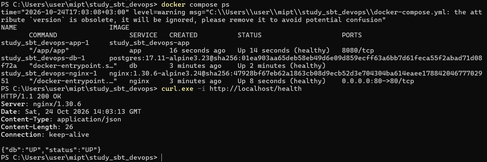
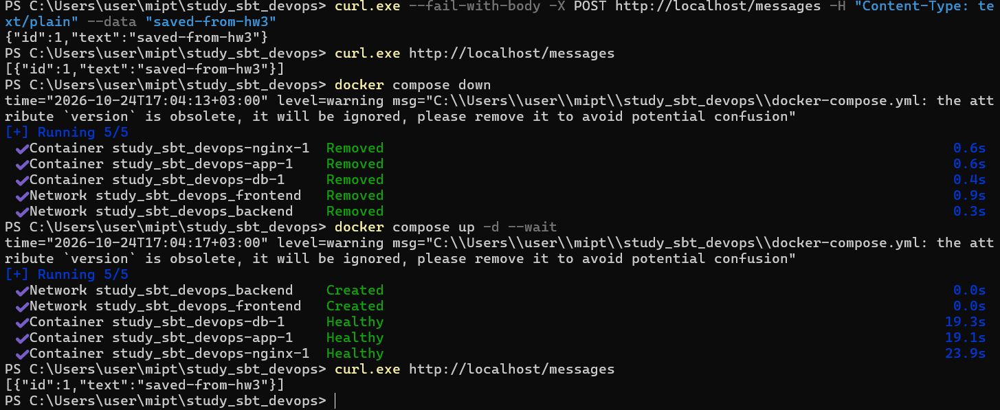

# ДЗ №3. Многоконтейнерное приложение

Стек описан в [docker-compose.yml](docker-compose.yml), версия `3.8`.
Приложение на Go сохраняет сообщения в PostgreSQL. Исходники:
[main.go](main.go), [store.go](store.go).

| Сервис | Назначение | Сети | Опубликованный порт |
| --- | --- | --- | --- |
| nginx | Reverse proxy к приложению | frontend | 80:80 |
| app | HTTP API | frontend, backend | — |
| db | PostgreSQL | backend | — |

Сеть `backend` — внутренняя. Данные PostgreSQL хранятся в именованном томе
`pgdata`. Запуск зависимых сервисов ожидает успешных healthcheck.
Приложение собирается multi-stage Dockerfile и работает от UID/GID `10001`.

## Запуск

Требования: Docker Desktop в режиме Linux containers, Docker Compose v2, Git.
Команды выполняются в PowerShell.

```powershell
git clone --branch hw3 https://github.com/gamidaliev/study_sbt_devops.git
cd study_sbt_devops
Copy-Item .env.example .env
(Get-Content .env) -replace '^POSTGRES_PASSWORD=$', ('POSTGRES_PASSWORD=' + [guid]::NewGuid().ToString('N')) | Set-Content .env -Encoding ascii
docker compose up -d
```

Локальный `.env` содержит имя базы, пользователя и сгенерированный пароль;
он исключён из Git и контекста сборки. В `.env.example` секретов нет.

## Проверка

```powershell
docker compose ps
curl.exe -i http://localhost/health
curl.exe http://localhost/
```

Ожидаемый ответ `/health`: **HTTP 200**, `{"db":"UP","status":"UP"}`.
Запрос проходит через Nginx и проверяет доступность PostgreSQL.
В `docker compose ps` публикация на хост есть только у Nginx: `80:80`.
Порты `8080/tcp` и `5432/tcp` без адреса хоста не являются опубликованными.

## Проверка сохранения данных

```powershell
curl.exe --fail-with-body -X POST http://localhost/messages -H "Content-Type: text/plain" --data "saved-from-hw3"
curl.exe http://localhost/messages
docker compose down
docker compose up -d --wait
curl.exe http://localhost/messages
```

Запись `saved-from-hw3` сохраняется после удаления и повторного создания
контейнеров. `docker compose down` сохраняет том `pgdata`; флаг `-v` удаляет данные.

## Публикация образа приложения

[scripts/build-push.ps1](scripts/build-push.ps1) собирает образ и выполняет
`docker push`. Пример для аккаунта Docker Hub с правами записи в репозиторий:

```powershell
$RegistryUser = 'dockerhub-user'
docker login --username $RegistryUser
.\scripts\build-push.ps1 -Image "${RegistryUser}/study-sbt-devops:hw3-v1"
```

## Остановка

```powershell
docker compose down
```

## Результаты проверки на Windows

Все три сервиса находятся в состоянии **healthy**. Запрос через Nginx возвращает
**HTTP 200**, PostgreSQL доступен. На хост опубликован только порт **80** Nginx.



Запись `saved-from-hw3` с `id=1` сохранилась после `docker compose down`
и повторного создания контейнеров командой `docker compose up -d --wait`.


