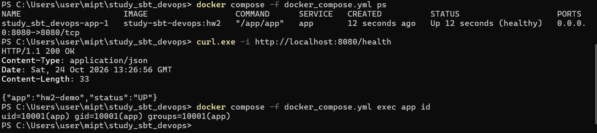

# study_sbt_devops

Практикум по дизайну и разработке информационных систем, 2026.

## ДЗ №2. Сначала сборка, потом runtime

Небольшое HTTP-приложение на Go со стандартной библиотекой. Условие разрешает
использовать другое приложение вместо Spring Boot. Все исходники находятся в
`main.go`; внешний сервер, база данных, локальная установка Go и Java для запуска
лабораторной не нужны.

Эндпоинты:

| Запрос | Ответ |
| --- | --- |
| `GET /health` | HTTP 200, `{"app":"hw2-demo","status":"UP"}` |
| `GET /` | HTTP 200, `{"message":"Hello from hw2-demo"}` |

`APP_NAME` меняет название в ответах, `APP_PORT` — порт прослушивания внутри
контейнера (по умолчанию `8080`). Неверный порт приводит к завершению с кодом 1.
Приложение слушает все интерфейсы; при SIGTERM корректно завершает HTTP-сервер.

## 1. Подготовка на Windows

Нужны Git и запущенный Docker Desktop в режиме **Linux containers** с Docker
Compose v2. Команды ниже выполняются в **PowerShell**. В Windows PowerShell
используем именно `curl.exe`, поскольку `curl` может быть псевдонимом другой команды.

Если репозиторий ещё не склонирован:

```powershell
git clone --branch hw2 https://github.com/gamidaliev/study_sbt_devops.git
cd study_sbt_devops
```

Если уже склонирован, открой PowerShell в его папке и выполни:

```powershell
git fetch origin
git switch hw2
git pull --ff-only origin hw2
```

При первом переключении Git создаст локальную `hw2` из `origin/hw2` автоматически.
Сначала сохрани незакоммиченные изменения, если они есть.

```powershell
docker version
docker compose version
docker info --format '{{.OSType}}'
```

Последняя команда должна показать `linux`. Для первой сборки нужен интернет,
чтобы скачать базовые образы. Сторонних Go-зависимостей нет.

## 2. Сборка и запуск через Compose

Файл намеренно назван `docker_compose.yml`, как в задании, поэтому всегда
указываем его через `-f`.

```powershell
docker compose -f docker_compose.yml up -d --build --wait --wait-timeout 120
docker compose -f docker_compose.yml ps
curl.exe --fail-with-body -i http://localhost:8080/health
```

Ожидаются состояние **healthy**, строка **HTTP/1.1 200 OK** и JSON
`{"app":"hw2-demo","status":"UP"}`. Это пример ожидаемого ответа, а не отчёт о запуске.
Если версия Compose не поддерживает `--wait`, обнови Docker Desktop либо запусти
`up -d --build` без флагов ожидания и проверь `ps` через 10–20 секунд.

Настройки Compose можно переопределить через переменные текущего PowerShell:

```powershell
$env:APP_NAME = 'my-devops-lab'
$env:HOST_PORT = '8081'
docker compose -f docker_compose.yml up -d --build --wait
curl.exe --fail-with-body -i http://localhost:8081/health
```

Внутри контейнера Compose оставляет `APP_PORT=8080`; `HOST_PORT` меняет только
порт на Windows. Для возврата к настройкам по умолчанию:

```powershell
Remove-Item Env:APP_NAME -ErrorAction SilentlyContinue
Remove-Item Env:HOST_PORT -ErrorAction SilentlyContinue
docker compose -f docker_compose.yml up -d --wait
```

Логи и остановка:

```powershell
docker compose -f docker_compose.yml logs --tail 50 app
docker compose -f docker_compose.yml down
```

## 3. Приёмка через обычный docker run

Сначала останови Compose командой `down`, чтобы освободить порт 8080.

```powershell
docker build --pull --target runtime -t study-sbt-devops:hw2 .
docker run -d --name hw2-app -p 8080:8080 -e APP_NAME=run-demo study-sbt-devops:hw2
curl.exe --fail-with-body -i http://localhost:8080/health
docker ps --filter name=hw2-app
docker inspect --format '{{.State.Health.Status}}' hw2-app
docker exec hw2-app id
```

Ответ `/health` должен содержать `"app":"run-demo"`. Статус healthcheck через
10–20 секунд — `healthy`; `id` показывает UID/GID `10001`, а не root.
Команда `HEALTHCHECK` встроена в образ и работает также без Compose.

Проверка другого **внутреннего** порта (не запускать одновременно с предыдущим
контейнером на порту Windows 8080):

```powershell
docker rm -f hw2-app
docker run -d --name hw2-app -p 8080:9090 -e APP_PORT=9090 -e APP_NAME=custom-port study-sbt-devops:hw2
curl.exe --fail-with-body -i http://localhost:8080/health
docker exec hw2-app /app/app healthcheck
docker rm -f hw2-app
```

## 4. Проверка безопасности и устройства образа

После запуска через Compose:

```powershell
docker compose -f docker_compose.yml exec app id
docker image inspect study-sbt-devops:hw2 --format '{{.Config.User}}'
docker image inspect study-sbt-devops:hw2 --format '{{json .Config.Entrypoint}}'
docker image inspect study-sbt-devops:hw2 --format '{{json .Config.Healthcheck}}'
docker image ls study-sbt-devops:hw2
```

| Требование | Реализация |
| --- | --- |
| Multi-stage build | `builder` компилирует и тестирует, `runtime` получает только бинарный файл |
| Фиксированные версии | `golang:1.26.10-alpine3.23`, `alpine:3.23.7`, обе ссылки дополнительно закреплены по SHA-256 digest |
| Компактный runtime | Alpine, без Go SDK, исходников и дополнительных пакетов |
| Non-root | Пользователь и группа `app`, UID/GID `10001` |
| ENV | `APP_NAME`, `APP_PORT`, их можно задать через `docker run -e` |
| EXPOSE | Документирует внутренний порт `8080`; публикация выполняется через `-p` |
| HEALTHCHECK | Exec-форма `["/app/app", "healthcheck"]`, HTTP-запрос к локальному `/health` |
| ENTRYPOINT | Exec-форма `["/app/app"]`, приложение напрямую получает сигналы Docker |
| Дополнительные ограничения | Compose: read-only filesystem, `cap_drop: ALL`, `no-new-privileges`, лимиты CPU, памяти и процессов |

`ENV` и `EXPOSE` не являются командами запуска и не имеют exec-формы;
JSON exec-форма применяется к `ENTRYPOINT` и команде `HEALTHCHECK`.
Проверка здоровья учитывает `APP_PORT`, имеет таймаут и завершает процесс с
кодом 1 при недоступности сервера или ответе, отличном от 200.
Для неё не устанавливается `curl` и не запускается shell.

Оптимизация сборки: `.dockerignore` пропускает только необходимые файлы;
`go.mod` копируется до исходников; `-trimpath`, `-buildvcs=false` и пустой
build ID убирают пути рабочей машины и VCS-метаданные, `-s -w` уменьшают бинарник.
`CGO_ENABLED=0` исключает зависимость от динамических C-библиотек.
Бинарник принадлежит root и доступен приложению только для чтения и исполнения.

Сборка не скачивает Go-модули (`GOPROXY=off`, `GOTOOLCHAIN=local`), так как
используется только стандартная библиотека. Поэтому `go.sum` отсутствует.
Тесты запускаются в стадии `builder`; при их ошибке сборка прекращается.
Registry технически может переназначить тег, поэтому обе инструкции `FROM`
содержат также SHA-256 digest: `image:tag@sha256:...`. Это фиксирует содержимое
базовых образов. Для переноса уже собранного результата запускай опубликованный
образ по digest (см. ниже). Битовая идентичность всего OCI-образа между разными
версиями BuildKit не заявляется; зафиксированы исходники, toolchain и базовые слои.

## 5. Сборка и публикация в registry

В репозитории есть скрипт **`scripts/build-push.ps1`**. Он собирает runtime-образ,
проверяет код завершения Docker и загружает образ в указанный registry.
Пароли и токены в скрипт, Git и параметры команд не помещаются.

Пример с Docker Hub: сначала создай репозиторий `study-sbt-devops` в своём
аккаунте Docker Hub и авторизуйся интерактивно. Имя аккаунта Docker Hub может
отличаться от имени на GitHub — при необходимости замени `gamidaliev` ниже.

```powershell
docker login --username gamidaliev
.\scripts\build-push.ps1 -Image 'gamidaliev/study-sbt-devops:hw2-v1'
```

Токен доступа вводится в запросе Docker, а не в чате и не в исходниках.
Для другого registry, например GHCR, передай полный адрес:

```powershell
docker login ghcr.io --username gamidaliev
.\scripts\build-push.ps1 -Image 'ghcr.io/gamidaliev/study-sbt-devops:hw2-v1'
```

Выбери один подходящий registry. Для GHCR нужен токен с правами публикации
пакетов; приватный образ на другой машине потребует авторизации на чтение.
Если PowerShell блокирует `.ps1` политикой выполнения, те же действия вручную:

```powershell
docker build --pull --target runtime -t gamidaliev/study-sbt-devops:hw2-v1 .
docker push gamidaliev/study-sbt-devops:hw2-v1
```

Публикация действительно произойдёт только после успешного `docker push`.
На другой машине с совместимой архитектурой CPU:

```powershell
docker pull gamidaliev/study-sbt-devops:hw2-v1
docker run -d --name hw2-app -p 8080:8080 -e APP_NAME=another-machine gamidaliev/study-sbt-devops:hw2-v1
curl.exe --fail-with-body -i http://localhost:8080/health
```

Для запуска строго того же артефакта после push узнай digest:

```powershell
docker image inspect gamidaliev/study-sbt-devops:hw2-v1 --format '{{json .RepoDigests}}'
```

Скопируй полученную ссылку вида `gamidaliev/study-sbt-devops@sha256:...` и
используй её вместо тега в `docker pull`/`docker run`. Сборка в примере рассчитана
на архитектуру текущего Docker Engine; это не multi-platform публикация.

## 6. Тесты приложения отдельно от Docker

При установленном Go 1.26.10:

```powershell
go test -count=1 -v ./...
go vet ./...
```

Тесты проверяют контракт `/health`, отказ healthcheck при ошибочном HTTP-статусе
или недоступном сервере, допустимые и недопустимые значения `APP_PORT`.

## 7. Скриншоты для сдачи

Приложение проверено на Windows с Docker Desktop. На одном скриншоте показаны:

- контейнер `study_sbt_devops-app-1` в состоянии **healthy**;
- запрос `GET /health`: **HTTP/1.1 200 OK**, JSON со статусом `UP`;
- запуск от пользователя `app` с UID/GID **10001**.



Описание команд: [screenshots/README.md](screenshots/README.md).

## Материалы

Использованы темы из предоставленных лекций: образ и контейнер, слои,
инструкции Dockerfile, публикация портов, registry, Docker Compose, cgroups:

- [Docker — вводная](https://drive.google.com/file/d/1TeaU8vmNHzrelNjwY1EpQ9hPxxbr2_x_/view).
- [Docker — инструкции и команды](https://drive.google.com/file/d/13G5gWyBcyD5Iy12_0iZVHWxWdfh-raMg/view).
- [Официальный справочник Dockerfile](https://docs.docker.com/reference/dockerfile/).
- [Multi-stage builds](https://docs.docker.com/build/building/multi-stage/).

В лекции встречается `docker-compose` и поле `version`; здесь используются
современная команда `docker compose` и Compose Specification без устаревшего
поля `version`. Дополнительные требования из задания (multi-stage, non-root,
exec healthcheck) реализованы непосредственно в Dockerfile.
